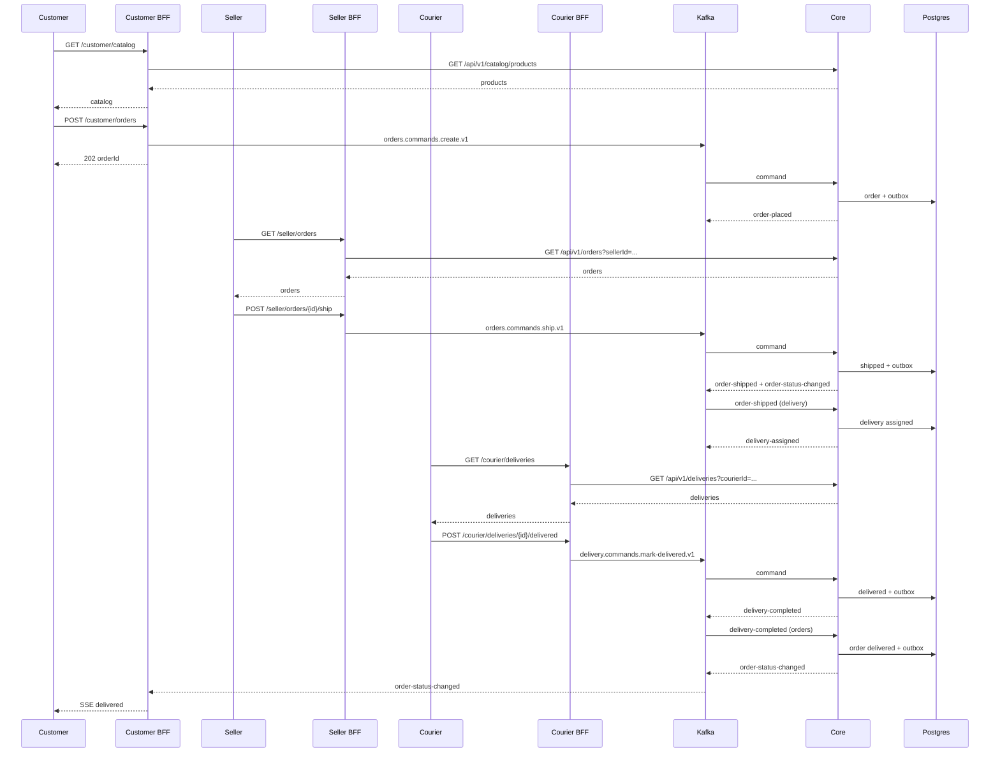

# MVP Scope

> **Статус:** Accepted for MVP implementation
> **Версия:** 1.0 (2026-11-27)
> **Связанные документы:** [architecture.md](./architecture.md), [ADR](./adr/), [contracts](./contracts/)

## Одна фраза

Покупатель видит каталог, кладёт товар в корзину, оформляет заказ.
Продавец видит заказ и меняет его статус. Курьер видит назначенный заказ
и отмечает доставку. Покупатель видит статус заказа в реальном времени.

---

## 1. Роли и доступ

| Роль | Что делает | Доступ |
|---|---|---|
| **Покупатель** (`customer`) | Каталог, корзина, checkout, статус своих заказов | `X-User-Id` + `X-User-Role: customer` |
| **Продавец** (`seller`) | Список своих заказов, отгрузка своих позиций | `X-User-Id` + `X-User-Role: seller` |
| **Курьер** (`courier`) | Список назначенных доставок, отметка `delivered` | `X-User-Id` + `X-User-Role: courier` |

**Auth в MVP — stub:** BFF доверяет заголовкам `X-User-Id`, `X-User-Role`,
`X-Tenant-Id` (см. architecture.md §9). Логин, регистрация, JWT/OIDC,
восстановление пароля — **out of scope**.

---

## 2. In scope (MVP)

### 2.1. Покупатель

- **Каталог**
  - Список товаров: `GET /customer/catalog` (пагинация, поиск, фильтр по продавцу).
  - Карточка товара: `GET /customer/catalog/{productId}`.
- **Корзина**
  - Добавить / убрать / изменить количество — **на клиенте** (state + `localStorage`).
  - Серверной корзины, таблицы `carts` и команд `cart.*` в MVP нет.
- **Оформление заказа**
  - `POST /customer/orders` с `Idempotency-Key`.
  - Передаются `items[{productId, quantity}]`, `deliveryAddress`, `recipient`.
  - Цена, продавец и доступность определяются **каталогом на сервере**.
- **Статус заказа**
  - `GET /customer/orders/{orderId}` — текущий статус.
  - `GET /customer/orders/{orderId}/stream` — SSE-статус в реальном времени.
  - Fallback: polling `GET /customer/orders/{orderId}`.

### 2.2. Продавец

- **Список поступивших заказов**
  - `GET /seller/orders` — заказы, где есть позиции продавца.
  - Продавец видит **только свои позиции** и статус заказа.
- **Смена статуса**
  - `POST /seller/orders/{orderId}/ship` с `Idempotency-Key`.
  - Отгружает только позиции текущего продавца.
  - При одном продавце: `new → shipped`.
  - При нескольких: `new → partially_shipped → shipped`.

### 2.3. Курьер

- **Список назначенных доставок**
  - `GET /courier/deliveries` — только доставки текущего курьера.
- **Отметка доставки**
  - `POST /courier/deliveries/{deliveryId}/delivered` с `Idempotency-Key`.
  - Разрешено только из `assigned`/`picked_up`.
  - После отметки заказ переходит в `delivered`.

### 2.4. Системные требования MVP

- Kafka-команды и события, единый конверт.
- Transactional Outbox + идемпотентные consumer'ы.
- DLQ для ошибок обработки.
- Внутренний read-only HTTP API ядра для BFF.
- SSE для статуса заказа.
- Seed/demo-данные: продавец, покупатель, курьер, товары.
- JSON Schema контракты + OpenAPI BFF.
- E2E-сценарий на testcontainers.

---

## 3. Out of scope (MVP)

- Оплата (Payments), возвраты, сверки.
- Отзывы и рейтинги.
- Чат поддержки.
- Аналитика и отчёты.
- Мультитенантность и white-label.
- Уведомления (email/push) как продуктовый сценарий.
- Админ-панель, ручной диспетчер.
- Мобильные приложения.
- Логин/регистрация/JWT/OIDC.
- Отмена заказа.
- Резервирование остатков (проверка есть, резерва нет).
- Адресная книга, редактирование адреса, геокодинг.
- Раздельные доставки для частичных отгрузок.
- Schema Registry/Protobuf.
- Kafka request-reply.
- WebSocket (используем SSE).
- Материализованные read-модели/read-БД.

---

## 4. Статусная модель

Канонические статусы (wire/API/БД) — ADR-0007:

| Статус | Значение | Кто переводит |
|---|---|---|
| `new` | Заказ создан, ничего не отгружено | `orders` при создании |
| `partially_shipped` | Часть позиций отгружена | `orders` при `ship` |
| `shipped` | Все позиции отгружены | `orders` при последнем `ship` |
| `delivered` | Доставка завершена | `orders` по `delivery-completed` |

Переходы:

```
new ──ship (часть)──▶ partially_shipped ──ship (последняя)──▶ shipped ──delivery-completed──▶ delivered
new ──ship (все)──────────────────────────────────────────────▶ shipped
```

Запрещено:

- `new`/`partially_shipped` → `delivered`;
- любой переход из `delivered`;
- повторная отгрузка того же продавца;
- отгрузка чужих позиций.

> В коде сейчас `CREATED`; на границе API/событий он мапится в `new`.
> `DELIVERED` и `delivered_at` добавляются в Phase 5–6.

---

## 5. Сквозной сценарий walking skeleton

### 5.1. Подготовка (seed)

1. Создан продавец `seller-1` (роль `seller`).
2. Создан курьер `courier-1` (роль `courier`).
3. Создан товар `product-1` продавца `seller-1`, цена 100.00 RUB, остаток 10.
4. Покупатель `customer-1` (роль `customer`).

### 5.2. Шаги

| # | Актор | Действие | Команда/событие | Ожидаемое состояние |
|---|---|---|---|---|
| 1 | Покупатель | `GET /customer/catalog` | — | Видит `product-1` |
| 2 | Покупатель | Добавляет товар в корзину (клиент) | — | В корзине 2 шт. |
| 3 | Покупатель | `POST /customer/orders` + `Idempotency-Key` | `orders.commands.create.v1` | `202`, `orderId`, статус `new` |
| 4 | Ядро | Создаёт заказ, считает цену | `orders.events.order-placed.v1` | Заказ в БД, outbox |
| 5 | Покупатель | `GET /customer/orders/{id}` / SSE | — | `new` |
| 6 | Продавец | `GET /seller/orders` | — | Видит заказ, только свои позиции |
| 7 | Продавец | `POST /seller/orders/{id}/ship` | `orders.commands.ship.v1` | `202` |
| 8 | Ядро | Отгружает позиции | `orders.events.order-shipped.v1`, `orders.events.order-status-changed.v1` | `shipped` |
| 9 | Delivery | Создаёт доставку и назначает курьера | `delivery.events.delivery-assigned.v1` | `Delivery.status = assigned` |
| 10 | Курьер | `GET /courier/deliveries` | — | Видит доставку |
| 11 | Курьер | `POST /courier/deliveries/{id}/delivered` | `delivery.commands.mark-delivered.v1` | `202` |
| 12 | Delivery | Завершает доставку | `delivery.events.delivery-completed.v1` | `Delivery.status = delivered` |
| 13 | Orders | Переводит заказ | `orders.events.order-status-changed.v1` | `delivered` |
| 14 | Покупатель | SSE / `GET` | — | Видит `delivered` |
| 15 | Все | Повтор шагов 3, 7, 11 с тем же `Idempotency-Key` | — | Дублей нет |

### 5.3. Диаграмма



---

## 6. Acceptance criteria

Формат: Given / When / Then. Все критерии обязательны для MVP.

### 6.1. Каталог

**AC-1. Список товаров**
- Given в каталоге есть товары,
- When покупатель вызывает `GET /customer/catalog`,
- Then возвращается страница `{items, page, pageSize, total}`, товары содержат
  `productId`, `sellerId`, `name`, `price`, `availableQuantity`.

**AC-2. Карточка товара**
- Given товар существует,
- When `GET /customer/catalog/{productId}`,
- Then 200 с данными товара; для неизвестного id — 404.

### 6.2. Корзина

**AC-3. Добавление/удаление**
- Given покупатель на странице каталога,
- When добавляет товар, затем убирает,
- Then корзина на клиенте содержит/не содержит товар; серверных записей
  корзины не создаётся.

### 6.3. Checkout

**AC-4. Успешное оформление**
- Given товар доступен, адрес и получатель заполнены,
- When `POST /customer/orders` с `Idempotency-Key`,
- Then 202, `orderId`, заказ создан со статусом `new`, цена взята из каталога,
  `totalAmount` рассчитан на сервере.

**AC-5. Неверные данные**
- Given пустая корзина / `quantity <= 0` / неизвестный товар /
  недостаточный остаток,
- When checkout,
- Then BFF отклоняет запрос до публикации команды: 422/404/409 с
  RFC 7807; заказ не создан. Ядро дополнительно перепроверяет данные.

**AC-6. Идемпотентность checkout**
- Given заказ уже создан с `Idempotency-Key`,
- When тот же POST повторяется,
- Then второго заказа нет, возвращается тот же `orderId`.

**AC-7. Цена не из клиента**
- Given клиент пытается передать свою цену,
- When checkout,
- Then цена игнорируется/отклоняется; используется цена каталога.

### 6.4. Продавец

**AC-8. Список заказов**
- Given у продавца есть заказы,
- When `GET /seller/orders`,
- Then возвращаются только заказы с его позициями; в каждой позиции —
  только его товары; адрес, телефон получателя, `customerId` и общая
  сумма заказа не возвращаются.

**AC-9. Отгрузка**
- Given заказ `new` и продавец — участник,
- When `POST /seller/orders/{id}/ship`,
- Then 202; после обработки команды статус `shipped` (single seller) или
  `partially_shipped` (multi-seller), событие `order-shipped` опубликовано.
  Итоговый статус клиент читает через `GET /seller/orders/{id}`.

**AC-10. Чужой заказ**
- Given продавец не участвует в заказе,
- When `POST .../ship`,
- Then BFF отклоняет запрос по данным read API: 403/409, команда не
  публикуется, статус не меняется.

**AC-11. Повторная отгрузка**
- Given продавец уже отгрузил свои позиции,
- When повторный `ship` с новым `messageId`,
- Then BFF возвращает 409 по read API (или ядро отклоняет
  `CannotShipOrderError` и команда уходит в DLQ), событие не публикуется.

### 6.5. Курьер и доставка

**AC-12. Автоназначение**
- Given заказ перешёл в `shipped` и есть активный курьер,
- When delivery обрабатывает `order-shipped`,
- Then создаётся `Delivery` со статусом `assigned`, `courierId` заполнен,
  опубликовано `delivery-assigned`.

**AC-13. Список доставок**
- Given у курьера есть назначения,
- When `GET /courier/deliveries`,
- Then возвращаются только его доставки; чужие недоступны.

**AC-14. Отметка delivered**
- Given доставка `assigned`/`picked_up` и курьер — владелец,
- When `POST /courier/deliveries/{id}/delivered`,
- Then 202; после обработки команды `Delivery.status = delivered`,
  `deliveredAt` заполнен, опубликовано `delivery-completed`, заказ стал
  `delivered`. Клиент читает результат через read API/SSE.

**AC-15. Чужая доставка**
- Given курьер не назначен на доставку,
- When `POST .../delivered`,
- Then BFF отклоняет запрос по данным read API: 403, команда не
  публикуется, статус не меняется.

**AC-16. Доставка до отгрузки**
- Given заказ `new`,
- When кто-то пытается отметить доставку,
- Then 409 (нет доставки/неверный статус), перехода в `delivered` нет.

### 6.6. Статус и realtime

**AC-17. Статус покупателя**
- Given заказ принадлежит покупателю,
- When `GET /customer/orders/{id}`,
- Then 200 с актуальным статусом; чужой заказ — 404/403.

**AC-18. SSE**
- Given покупатель подключён к `/customer/orders/{id}/stream`,
- When статус меняется (`new → shipped → delivered`),
- Then приходят события `status` с `orderId`, `status`, `fromStatus`,
  `changedAt`, `version`; при реконнекте с `Last-Event-ID` — snapshot +
  продолжение потока.

**AC-19. Fallback**
- Given SSE недоступен,
- When клиент поллит `GET /customer/orders/{id}`,
- Then видит актуальный статус.

### 6.7. Надёжность и безопасность

**AC-20. Идемпотентность команд**
- Given команда обработана,
- When повторяется с тем же `messageId`,
- Then handler не выполняется повторно, дублей в БД/событиях нет.

**AC-21. DLQ**
- Given сообщение не десериализуется или handler падает,
- When consumer обрабатывает,
- Then raw bytes уходят в `{topic}.dlq.v1`, consumer продолжает работу.

**AC-22. Auth-stub**
- Given нет `X-User-Id`/`X-User-Role` или роль не соответствует endpoint,
- When запрос в BFF,
- Then 401/403; команда не публикуется.

**AC-23. Видимость**
- Given покупатель/продавец/курьер,
- When читает данные,
- Then видит только свои заказы/позиции/доставки; чужие — 403/404.

---

## 7. Definition of Done (MVP)

MVP считается выполненным, когда:

### 7.1. Документация

- [x] `contracts/topics.md` синхронизирован с `create-topics.sh`.
- [x] `architecture.md` отражает read path, realtime, auth, BFF↔core, DLQ.
- [x] ADR 0007–0011 приняты; ADR приведены к единой папке и нумерации.
- [x] `contracts/bff-openapi.yaml` создан.
- [x] JSON Schema событий/команд и `manifest.schema.json` созданы.
- [ ] `contracts/topics.md` синхронизирован с `create-topics.sh` (Phase 1).

### 7.2. Код

- [ ] Core read API (`/api/v1/...`) реализован.
- [ ] `delivery` модуль реализован; миграции применены.
- [ ] `customer-bff`, `seller-bff`, `courier-bff` реализованы.
- [ ] `bff-kit` реализован в объёме §10.3 architecture.
- [ ] SSE-статус работает.
- [ ] Auth-stub и проверка видимости.
- [ ] Seed/demo-скрипт.

### 7.3. Тесты

- [ ] Unit: домен, handlers, BFF-маппинг.
- [ ] Integration: репозитории, outbox, idempotency, delivery.
- [ ] E2E: полный сценарий §5.
- [ ] Contract: JSON Schema + OpenAPI + manifest.
- [ ] Негативные: чужие заказы/доставки, повторные команды, DLQ.

### 7.4. Эксплуатация

- [ ] `docker compose` поднимает core + BFF + инфраструктуру.
- [ ] Топики создаются автоматически/скриптом.
- [ ] CI зелёный (lint, types, tests, contracts).
- [ ] README с быстрым стартом и демо-сценарием.

### 7.5. Приёмка

- [ ] Все AC §6 проходят.
- [ ] E2E-сценарий §5 проходит на чистой БД.
- [ ] Нет P0/P1 дефектов.
- [ ] Демо можно повторить по README за ≤ 10 минут.

---

## 8. Ограничения и допущения MVP

1. **Один продавец в демо-заказах.** Домен поддерживает multi-seller,
   но демо и AC-9 проверяют прямой `new → shipped`.
2. **Корзина клиентская.** Нет серверной корзины и синхронизации устройств.
3. **Нет резервирования остатков.** Проверка `quantity <= available`
   в BFF (pre-validation) и в ядре, но без decrement/reserve; возможен
   oversell. Если остаток изменился между pre-validation и обработкой
   команды, ядро отклоняет команду в DLQ — синхронного ответа клиенту нет.
4. **Нет оплаты.** Заказ создаётся без платежа.
5. **Auth-stub.** Заголовки вместо JWT; production — future.
6. **SSE, не WebSocket.** Один инстанс BFF на кабинет.
7. **JSON, не Protobuf.** Schema Registry не используется.
8. **Одна доставка на заказ.** Частичные отгрузки не создают отдельные
   доставки.
9. **PII в событиях.** Адрес/телефон в `order-placed` для проекции
   delivery; retention/ACL — Phase 1+.
10. **Целевые задержки:** p95 read < 300 мс, p95 статус после команды < 2 с
    (локально).

---

## 9. Ссылки

- [architecture.md](./architecture.md)
- [ADR index](./adr/README.md)
- [BFF OpenAPI](./contracts/bff-openapi.yaml)
- [Core read API](./contracts/core-read-api.md)
- [Event contracts](./contracts/events/README.md)
- [Topics](./contracts/topics.md)
- [Manifest](./contracts/manifest.md)
